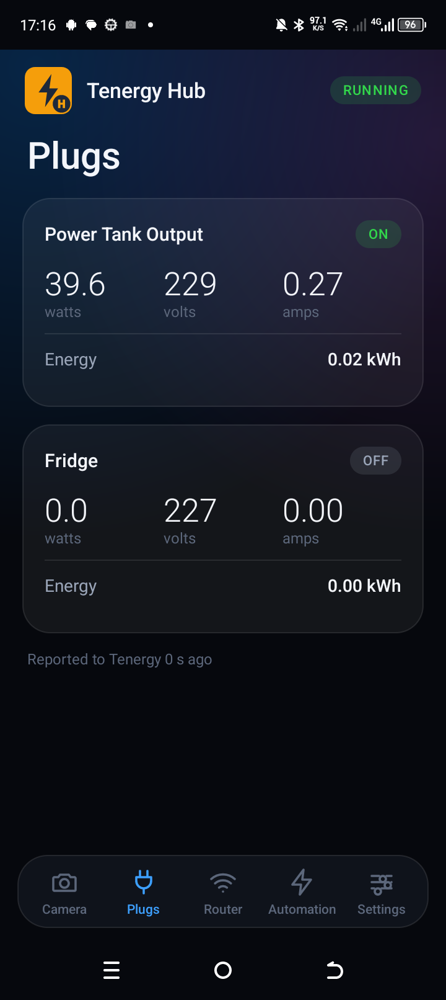
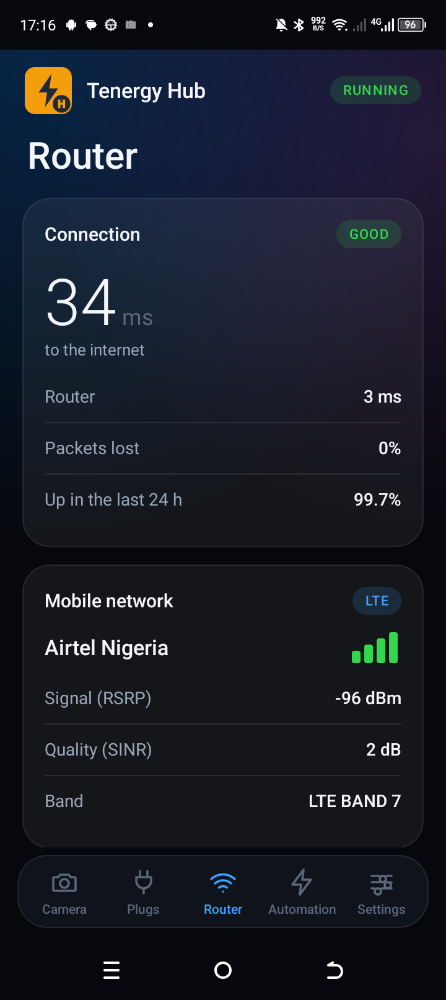
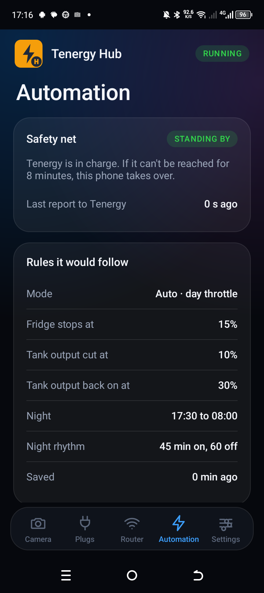
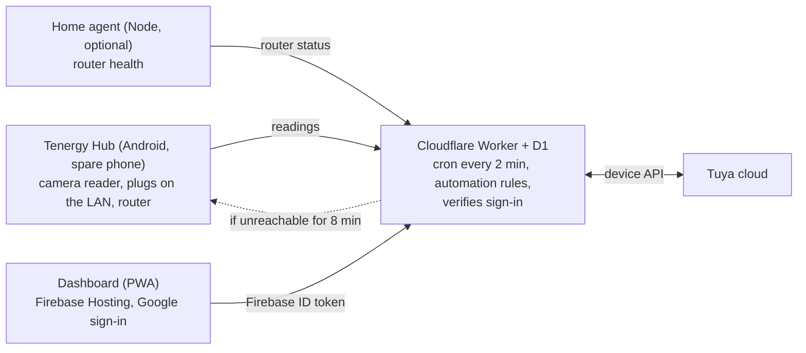

# Tenergy

Home power monitoring and automation. Tenergy watches a solar power tank and a fridge
through Tuya smart plugs, reads the tank's battery level and the grid light with a spare
phone's camera, tracks router health, and applies rules that protect the fridge and keep
the tank from running flat. A dashboard (installable web app) shows everything and works
from anywhere.

It is a personal project that runs every day at home, built to need **no credit card and
nothing running in the house**: it sits on free tiers (Firebase Spark, Cloudflare Workers).

| Plugs | Router | Automation |
| --- | --- | --- |
|  |  |  |

## How it fits together



- **Worker** (`worker/`): the always-on part. Talks to the Tuya cloud (the Tuya secret
  never leaves it), stores history in a D1 database, runs the automation on a 2-minute
  cron, and serves the dashboard's data. It checks the caller's **Firebase ID token** and
  only accepts allow-listed accounts.
- **Dashboard** (`public/`): a plain JavaScript PWA on Firebase Hosting with Google sign-in.
- **Tenergy Hub** (`android/`): a Kotlin app on a spare phone. It reads the tank battery and
  grid light with the camera, controls the plugs over the local network, reports to the
  Worker, and **takes over the rules itself** if the Worker can't be reached for 8 minutes.
- **Home agent** (`agent/`): an optional Node script that reports router health.

## Design decisions worth knowing

- **Three automation modes** (Auto, Manual, Absolute) with a small set of safety rules that
  always win, such as shedding the fridge on overload and cutting the tank output at a
  low battery level.
- **The night rhythm continues from where the fridge really is.** After a grid change, the
  on/off cycle picks up from the fridge's actual state instead of always resting first
  (`worker/src/auto.js`, `phaseAnchor`).
- **Camera readings use a majority vote** over several photos, and refuse to answer when
  they disagree (`worker/src/vote.js`).
- **The phone and the Worker run the same rules.** The Kotlin copy is kept in step with the
  JavaScript one by parity tests.
- **Secrets stay out of the code.** Tuya keys go in `wrangler secret`, local tooling reads
  git-ignored `.env` files, and the Android signing key lives in a git-ignored
  `keystore.properties`.

## Repository layout

| Path | What it is |
| --- | --- |
| `worker/` | Cloudflare Worker (API, automation, alerts), D1 schema, tests |
| `public/` | Dashboard PWA and Firebase web config |
| `android/` | Tenergy Hub app (Kotlin) with unit and parity tests, plus reference photos of the tank display used as test fixtures |
| `agent/` | Optional home agent and local probing tools |
| `process/` | Setup guides, brand assets, screenshots, helper scripts |

## Tests

```bash
npm test        # automation timing and camera-vote logic (Node, no dependencies)
```

The Android project also has unit and parity tests under `android/app/src/test/`, run from
Android Studio or Gradle.

## Running your own

Follow [`process/SETUP.md`](process/SETUP.md). The values in this repository belong to the
author's own deployment, so replace them with yours:

- `worker/wrangler.toml`: D1 `database_id`, `ALLOWED_EMAILS`, `ALLOWED_ORIGINS`, `FIREBASE_PROJECT`
- `public/firebase-config.js`: your Firebase web config and the Worker's URL
- `.firebaserc` and `firebase.json`: your Firebase project and support email
- Secrets: set `TUYA_ACCESS_ID`, `TUYA_ACCESS_SECRET` and `INGEST_KEY` with
  `npx wrangler secret put`, and copy `.env.example` files to `.env`

A Firebase web API key only identifies the project and is public by design; access is
controlled by Google sign-in and the Worker's allow-list.

Building the Android app needs Android Studio and your own `android/keystore.properties`
and `release.keystore`, which are deliberately not in the repository.
